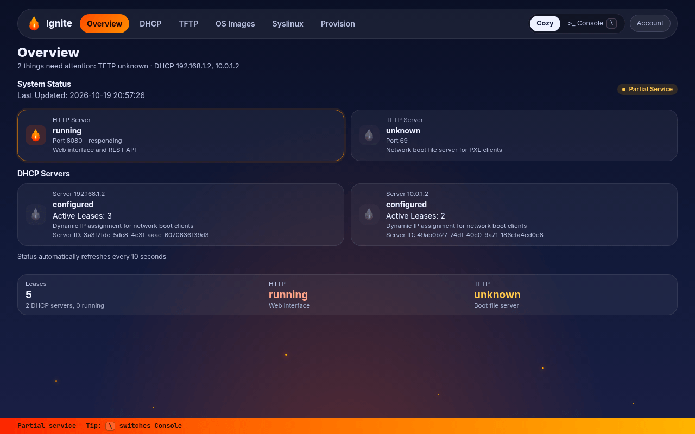
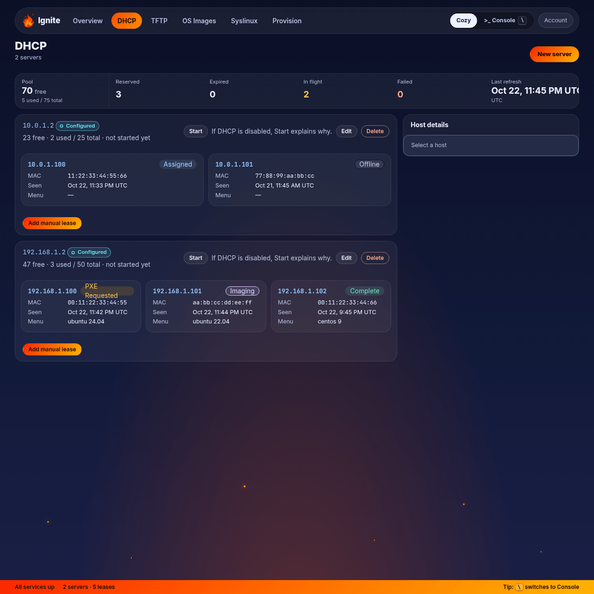
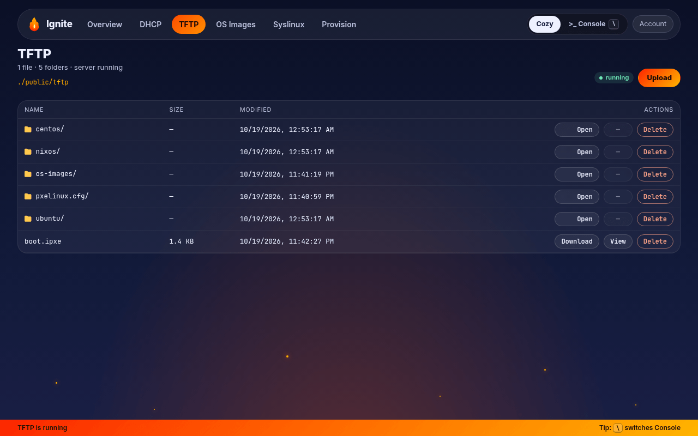
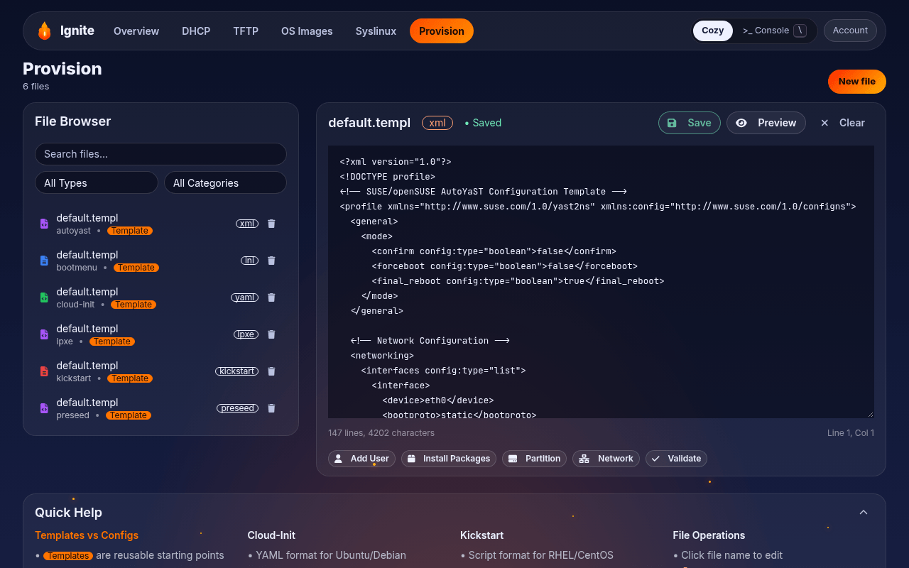
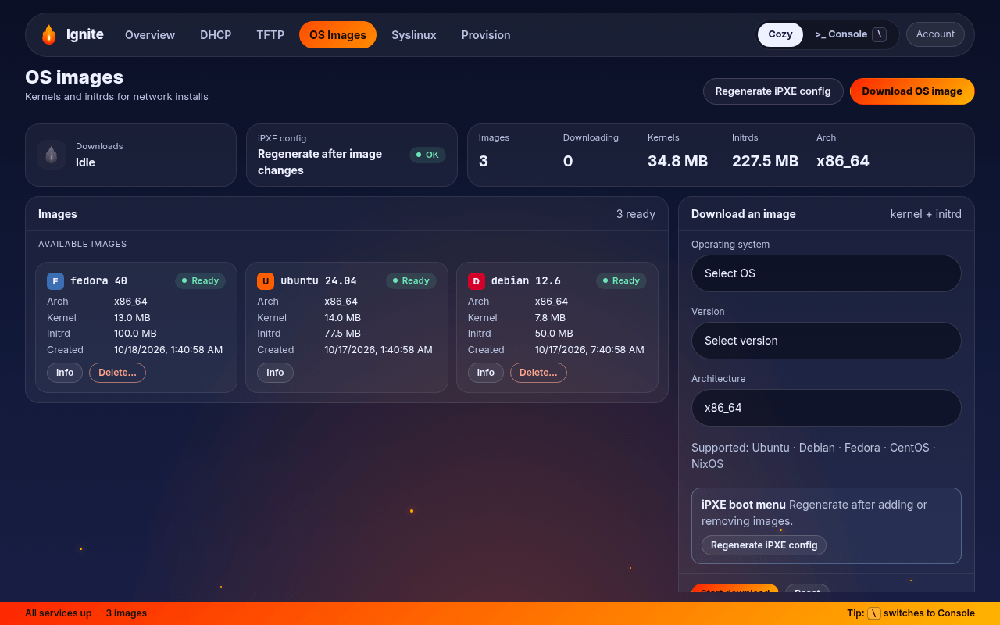
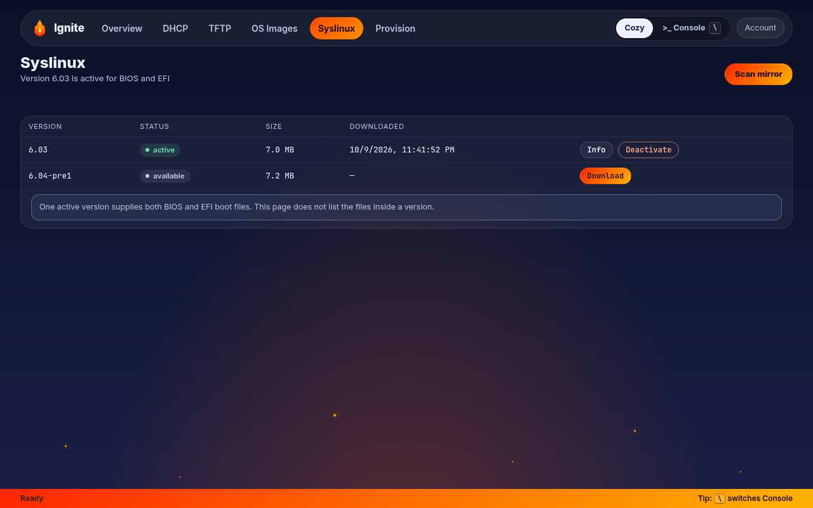

# Ignite

<p align="center">
  
</p>

Ignite is a powerful, all-in-one solution for network booting and server provisioning, implemented in Go. It simplifies the complexities of setting up network boot environments by integrating DHCP, TFTP, and a web-based management interface into a single, easy-to-use application.

## 🏆 Quality & Testing

Ignite features comprehensive test coverage across all components:

- **Comprehensive Unit Tests**: All packages include extensive test suites with mock implementations
- **Integration Testing**: VM-based testing with QEMU for end-to-end PXE boot validation  
- **Test Coverage**: Significant coverage across core packages (osimage, syslinux, handlers, routes, vmtest)
- **Quality Assurance**: Automated formatting (`gofmt`) and static analysis (`go vet`) validation

## Overview

Designed for developers, system administrators, and hobbyists, Ignite provides a streamlined workflow for managing PXE boot environments. Whether you're deploying operating systems, running diagnostics, or managing server configurations, Ignite offers the tools you need to get the job done efficiently.

## Features

- **Integrated DHCP Server**: Dynamically assign IP addresses to network devices.
- **Built-in TFTP Server**: Serve boot files (e.g., PXELinux, iPXE) to booting clients.
- **Web-Based Management UI**: A user-friendly interface to manage DHCP leases, configure boot menus, and monitor server status.
- **Dynamic PXE Boot Menu Templating**: Automatically generate PXE boot menus for different operating systems based on DHCP leases. Supported templates include:
  - Ubuntu
  - NixOS
  - Red Hat
- **Redfish API Integration**: Remotely manage servers and initiate PXE boot processes via the Redfish API.
- **Cloud-Init & Kickstart Templating**: Simplify automated OS installations with dynamic templating for cloud-init and Kickstart configurations.
- **Advanced File Management**: Template and configuration file browser with delete functionality and clear type distinction.
- **Enhanced Security**: Path validation, input sanitization, and secure file operations throughout the application.
- **Comprehensive Error Handling**: Detailed error messages, validation feedback, and graceful error recovery.

## Screenshots

Here's a comprehensive look at the Ignite web interface across all major features:

### **Main Dashboard**
The central hub providing system overview, quick actions, and navigation to all features.



### **DHCP Management** 
Complete DHCP server management with lease monitoring, reservations, and dynamic IP allocation.



### **TFTP File Management**
File browser and management interface for boot files, operating system images, and PXE configurations.



### **Provision Templates**
Cloud-init and Kickstart template editor with syntax highlighting, template management, file deletion, and clear distinction between templates and configs.



### **OS Images Management**
Download, manage, and deploy operating system images with progress tracking and version control.



### **Syslinux Configuration**
Advanced PXE boot menu configuration and SYSLINUX management interface.



## Getting Started

### Prerequisites

- **Go**: Version 1.21 or higher (tested with Go 1.23.4).
- **Node.js & npm**: For managing frontend dependencies.
- **Tailwind CSS**: For styling the web interface.
- **QEMU** (optional): For running integration tests (`qemu-system-x86_64`, `qemu-img`).
- **curl**: For API testing and health checks.
- A basic understanding of network booting concepts (DHCP, TFTP, PXE).

### Setup

1. **Clone the repository**:

   ```bash
   git clone https://github.com/your-username/ignite.git
   cd ignite
   ```

2. **Build and Run**:

   The easiest way to get started is by using the provided Makefile:

   ```bash
   make run
   ```

   This command will handle installing dependencies, building the CSS, and running the application.

3. **Access the Web UI**:

   Once the server is running, open your browser and navigate to `http://localhost:8080`.

### Development & Testing

**Running Tests**:

```bash
# Run all unit tests
go test ./...

# Run tests with coverage
go test -cover ./...

# Run vmtest integration tests (requires QEMU)
cd vmtest
go run vmtest.go 1    # Test boot files with QEMU built-in TFTP
go run vmtest.go 2    # Test ignite integration
go run vmtest.go logs # Show test logs
go run vmtest.go clean # Clean up test files
```

**Code Quality**:

```bash
# Format code
gofmt -w .

# Run static analysis
go vet ./...
```

**CLI Options**:

```bash
# Populate with mock data for testing
./ignite -mock-data

# Clear all data
./ignite -clear-data
```

### Configuration

Ignite can be configured via environment variables. Here are the available options:

| Variable    | Description                                    | Default            |
|-------------|------------------------------------------------|--------------------|
| `DB_PATH`   | Path to store the database file.               | `./`               |
| `DB_FILE`   | Name of the database file.                     | `ignite.db`        |
| `DB_BUCKET` | Database bucket name.                          | `dhcp`             |
| `TFTP_DIR`  | Directory for the TFTP server to serve files from. Created on startup. The release image sets `/app/public/tftp`. | `./public/tftp`   |
| `HTTP_DIR`  | Directory for the HTTP server to serve files from. | `./public/http`   |
| `HTTP_PORT` | Port for the HTTP server to listen on.         | `8080`             |
| `PROV_DIR`  | Directory for provisioning templates.          | `./public/provision` |
| `BMC_TLS_INSECURE` | Skip TLS verification for Redfish BMCs. Set to `true`, `1`, `yes`, or `on` only for a self-signed BMC. Any other value verifies certificates. | verify TLS |
| `BMC_SYSTEM_ID` | Redfish ComputerSystem `Id` when a BMC exposes more than one system. A `system_id` form field on `POST /pxe/submit_ipmi` overrides this. | first and only system |
| `COOKIE_SECURE` | `Secure` flag on `ignite_session` and `ignite_mode`. `auto` sets it only when the request is TLS or `X-Forwarded-Proto` is `https`. `true` always sets it. `false` never does. Any other value is `auto`. The CSRF token is not a cookie. | `auto` |

Startup logs the resolved TFTP root (`TFTP root: ...`), which is the absolute directory the server reads and writes. `TFTP_DIR` overrides the default. The directory is created if it is missing. When that directory cannot be created, Ignite falls back to a temporary directory named `ignite-tftp.*` under the system temp dir and logs a warning that boot files, OS images, and per-MAC configs will not survive a restart. The same warning is logged when `TFTP_DIR` itself points at a temp directory; the override is still used. The TFTP page shows the configured `TFTP_DIR` as given (`./public/tftp`, or `/app/public/tftp` in the image). When startup had to serve a temporary directory, the page shows that temporary path instead.

Both container images declare `VOLUME /app/public/tftp` after `./public` is copied in. A fresh named volume starts with the TFTP files shipped in the image (`boot.ipxe` and the OS directories). Mount it by name so boot files, downloaded OS images, and per-MAC configs survive a container recreate:

```bash
docker run -d \
  --name ignite \
  -p 8080:8080 \
  -p 69:69/udp \
  -v ignite-tftp:/app/public/tftp \
  ghcr.io/chadleeshaw/ignite:v3.0.0
```

Compose and a Swarm stack use the same syntax (`docker stack deploy -c docker-compose.yml ignite`):

```yaml
services:
  ignite:
    image: ghcr.io/chadleeshaw/ignite:v3.0.0
    ports:
      - "8080:8080"
      - "69:69/udp"
    volumes:
      - ignite-tftp:/app/public/tftp
volumes:
  ignite-tftp:
```

A bind mount of an empty host directory (`-v /path/on/host:/app/public/tftp` when `/path/on/host` is empty) hides those shipped files. Seed the host directory from the image, give it to the `ignite` user (uid 1001), then start Ignite with the bind mount. `docker cp` onto the host writes the files as root, and the app cannot create boot files in a directory it does not own. A named volume keeps the `ignite` ownership on its own.

```bash
mkdir -p /path/on/host
docker create --name ignite-seed ghcr.io/chadleeshaw/ignite:v3.0.0
docker cp ignite-seed:/app/public/tftp/. /path/on/host
docker rm ignite-seed
sudo chown -R 1001:1001 /path/on/host
```

Upgrading a v2.x container that was started without a TFTP mount: copy the directory out before removing the container, recreate it with the named volume, and restore the files. `docker cp` into the new container writes as root, so return ownership to the `ignite` user (uid 1001) afterward.

```bash
docker cp <container>:/app/public/tftp ./tftp-backup
# remove the old container, then start the new one with -v ignite-tftp:/app/public/tftp
docker cp ./tftp-backup/. <container>:/app/public/tftp
docker exec -u root <container> chown -R ignite:ignite /app/public/tftp
```

## API Reference

Ignite exposes a set of RESTful APIs to control and manage the server.

### GET Routes

| Endpoint                | Description                              |
|-------------------------|------------------------------------------|
| `/`                     | Serves the main index page.              |
| `/status`               | Redirects to Overview (`/`).             |
| `/status/content`       | Status fragment Overview polls.          |
| `/open_modal`           | Opens a modal dialog.                    |
| `/close_modal`          | Closes a modal dialog.                   |
| `/dhcp`                 | Serves the DHCP management page.         |
| `/dhcp/servers`         | DHCP server list. HTML fragment for htmx; JSON when `?format=json` or `Accept` is `application/json` without `text/html`. |
| `/provision`            | Serves the provisioning page.            |
| `/tftp`                 | Serves the TFTP management page.         |
| `/tftp/open`            | Opens a file in the TFTP directory.      |
| `/tftp/download`        | Downloads a file from the TFTP directory.|
| `/tftp/view`            | Views a file from the TFTP directory.    |
| `/tftp/serve`           | Serves a file from the TFTP directory.   |
| `/prov/gettemplates`    | Retrieves provisioning template options. |
| `/prov/loadtemplate`    | Loads a provisioning template.           |
| `/prov/getconfigs`      | Retrieves configuration options.         |
| `/prov/loadconfig`      | Loads a configuration file.              |
| `/prov/getfilename`     | Updates the filename for a template.     |
| `/provision/load-file`  | Loads file content via API.              |
| `/provision/gallery`    | Retrieves template gallery items.        |

`GET /dhcp/servers` returns an HTML fragment (`text/html`) for browsers and
htmx. Add `?format=json`, or send `Accept: application/json` without
`text/html`, for JSON:

```json
{
  "servers": [
    {
      "id": "server-id",
      "tftpip": "192.168.1.1",
      "status": "running",
      "lease_range": 50,
      "used": 1,
      "free": 49,
      "leases": [
        {
          "mac": "aa:bb:cc:dd:ee:ff",
          "ip": "192.168.1.100",
          "static": false,
          "state": "assigned",
          "state_badge_class": "badge-info",
          "state_display_name": "Assigned"
        }
      ]
    }
  ]
}
```

`status` is the listener state, and the same value on `/status/content`,
`/dashboard/summary` (`pools[].status`), and the DHCP page:

| Value | Meaning |
|-------|---------|
| `running` | The listener is bound and serving. |
| `stopped` | It was started and then stopped, or the last start failed. |
| `configured` | It is defined and has not been started since this process booted. |

A `configured` server does not make overall health `partial`. `used` and
`free` follow `dhcp.PoolOccupancy` (reserved or unexpired). Each lease
includes `menu_name` (a friendly label such as `ubuntu 24.04`, or `""`
when no menu is assigned) plus `menu`, `ipmi`, and `last_seen`. `menu`
does not include a filesystem path.

### POST Routes

| Endpoint                  | Description                                   |
|---------------------------|-----------------------------------------------|
| `/dhcp/create_server`     | Creates a new DHCP server configuration.      |
| `/dhcp/start`             | Starts a DHCP server.                         |
| `/dhcp/stop`              | Stops a DHCP server.                          |
| `/dhcp/delete`            | Deletes a DHCP server.                        |
| `/dhcp/submit_dhcp`       | Submits a new DHCP server configuration.      |
| `/dhcp/submit_reserve`    | Reserves a DHCP lease.                        |
| `/dhcp/remove_reserve`    | Removes a DHCP lease reservation.             |
| `/dhcp/delete_lease`      | Deletes a DHCP lease.                         |
| `/tftp/delete_file`       | Deletes a file from the TFTP directory.       |
| `/tftp/upload_file`       | Uploads a file to the TFTP directory.         |
| `/pxe/submit_menu`        | Submits a new PXE boot menu.                  |
| `/pxe/submit_ipmi`        | Redfish power and one-time PXE boot. Verifies TLS unless `BMC_TLS_INSECURE` is set. Powers On when the host is off and ForceRestart only when it is on. With more than one system and no `system_id` / `BMC_SYSTEM_ID`, responds `409`. |
| `/prov/newtemplate`       | Creates a new provisioning template.          |
| `/prov/save`              | Saves a provisioning file.                    |
| `/provision/save-file`    | Saves file content via API.                   |
| `/provision/delete-file`  | Deletes a file from provision directories.    |
| `/api/syslinux/activate/{version}` | Activates an already-downloaded SYSLINUX version. |

`POST /api/syslinux/activate/{version}` does not download the archive. The
version must already be downloaded. Activation removes the boot files
currently in the TFTP directories and installs that version's extracted
BIOS and EFI files. Other downloaded versions stay downloaded.

Success is `200` with:

```json
{"success": true, "message": "Syslinux 6.03 is active", "version": "6.03"}
```

| Status | When |
|--------|------|
| `409`  | The version exists but has not been downloaded. `error.user_message` is `This version is not downloaded. Download it before activating.` |
| `404`  | No stored version has that number. |
| `500`  | Boot files are missing or activation failed. |

## CSRF

Session-authenticated `POST`, `PUT`, and `DELETE` requests must send the
per-session token and a same-host `Origin`. This includes logout,
change-password, and every htmx POST. A missing or wrong token is `403`
with `error.user_message` `CSRF token mismatch`. A missing `Origin`, a
foreign `Origin`, or `Sec-Fetch-Site: cross-site` is `403` with
`Cross-site requests are not allowed`. `POST /auth/login` and the
per-lease host callbacks (`POST /dhcp/lease/{mac}/heartbeat` and
`POST /dhcp/lease/{mac}/state`) are exempt. `GET` does not require a token.

`ignite_mode` is an HttpOnly cookie. Page theme comes from `.Mode` in the
HTML, not from reading that cookie in JavaScript.

Every HTML render that uses the base page data includes `.CSRFToken`. The
frontend sends it in either place:

- Header `X-CSRF-Token` (htmx and fetch)
- Form field `csrf_token`

Add this to the base document, without storing the token in a cookie:

```html
<meta name="csrf-token" content="{{.CSRFToken}}">
```

```html
<body hx-headers='{"X-CSRF-Token": "{{.CSRFToken}}"}'>
```

State-changing forms also need:

```html
<input type="hidden" name="csrf_token" value="{{.CSRFToken}}">
```

Fetch clients that do not use htmx read the meta tag:

```js
headers: { "X-CSRF-Token": document.querySelector('meta[name="csrf-token"]').content }
```

`POST /auth/logout` needs the token when a session cookie is still present.

## Architecture

Ignite follows a clean, modular architecture with clear separation of concerns:

### Core Packages

- **`app/`**: Application lifecycle, dependency injection, and service orchestration
- **`dhcp/`**: DHCP server implementation with lease management and reservation support
- **`tftp/`**: TFTP server for serving boot files and OS images
- **`handlers/`**: HTTP request handlers with dependency injection for web API endpoints
- **`routes/`**: HTTP routing configuration and middleware setup
- **`config/`**: Configuration management with environment variable support
- **`db/`**: Database abstraction layer using BoltDB for persistent storage

### Specialized Components

- **`osimage/`**: OS image management with download tracking and file operations
- **`syslinux/`**: SYSLINUX boot file management and menu generation
- **`ipxe/`**: iPXE configuration generation and template rendering
- **`vmtest/`**: Integration testing framework using QEMU for end-to-end PXE testing

### Testing Strategy

- **Unit Tests**: Comprehensive test coverage with mock implementations for all external dependencies
- **Integration Tests**: Real-world testing using QEMU VMs to validate PXE boot workflows
- **Mock Services**: Testify-based mocks for database operations, file system interactions, and external services

## vmtest Integration Testing

The `vmtest/` package provides comprehensive integration testing capabilities:

```bash
cd vmtest
./setup-boot-files.sh    # One-time setup: download SYSLINUX boot files

# Test boot files with QEMU built-in TFTP (validates PXE menu display)
go run vmtest.go 1

# Test full ignite integration (DHCP server, API endpoints, VM boot)
go run vmtest.go 2

# View test results and VM serial output
go run vmtest.go logs

# Clean up test artifacts
go run vmtest.go clean
```

Integration tests validate:
- SYSLINUX boot file functionality
- DHCP server API endpoints
- Ignite web interface responsiveness  
- End-to-end PXE boot workflows
- VM network boot scenarios

## Deployment Options

### **Docker Deployment (Recommended)**

#### **Option 1: Pre-built Image**
```bash
docker run -d \
  --name ignite \
  -p 8080:8080 \
  -p 69:69/udp \
  -v $(pwd)/data:/app/data \
  -v ignite-tftp:/app/public/tftp \
  ghcr.io/chadleeshaw/ignite:v3.0.0
```

Compose and a Swarm stack (`docker stack deploy -c docker-compose.yml ignite`) mount the same named TFTP volume. The `./data` bind in the `docker run` example above is the database directory (`/app/data/ignite.db`). Generated provisioning files stay in `/app/public/provision`. The image does not declare a volume for either path.

```yaml
services:
  ignite:
    image: ghcr.io/chadleeshaw/ignite:v3.0.0
    ports:
      - "8080:8080"
      - "69:69/udp"
    volumes:
      - ignite-tftp:/app/public/tftp
volumes:
  ignite-tftp:
```

A bind mount of an empty host directory onto `/app/public/tftp` hides the boot files shipped in the image. Seed that directory from the image first, as described next to `TFTP_DIR` above. The same section has the v2.x upgrade steps: `docker cp <container>:/app/public/tftp ./tftp-backup`, then recreate with `ignite-tftp` and copy the backup back.

#### **Option 2: Build from Source**
```bash
# Full build (requires Go toolchain in container)
docker build -t ignite:local .

# Quick build using release binary (faster, smaller image)
docker build -f Dockerfile.release -t ignite:release .
docker run -d --name ignite -p 8080:8080 -p 69:69/udp -v ignite-tftp:/app/public/tftp ignite:release
```

### **Binary Installation**
```bash
# Download for your platform
wget https://github.com/chadleeshaw/ignite/releases/download/v3.0.0/ignite-linux-amd64
chmod +x ignite-linux-amd64
./ignite-linux-amd64

# Or use the x86_64 variant
wget https://github.com/chadleeshaw/ignite/releases/download/v3.0.0/ignite-x86_64
chmod +x ignite-x86_64
./ignite-x86_64
```

### **Development Setup**
```bash
git clone https://github.com/chadleeshaw/ignite.git
cd ignite
go mod download
go run . -mock-data    # Start with sample data
```

## Recent Improvements ✅

- ✅ **Enhanced error handling and user feedback** - Comprehensive error messages and validation throughout the application
- ✅ **IP address validation for DHCP configurations** - Input sanitization and validation for network configurations
- ✅ **TFTP directory path security improvements** - Path traversal protection and secure file operations
- ✅ **Interface standardization across services** - Consistent API patterns and dependency injection
- ✅ **Additional OS template support** - Extended template gallery with Docker, Kubernetes, and more
- ✅ **File management enhancements** - Delete functionality and template vs config distinction
- ✅ **Code optimization** - Removed unused code, optimized performance, fixed deprecated functions

## Security Model

Ignite uses a simple, network-focused security approach suitable for lab and infrastructure environments:

- **Single Admin Authentication**: Shared login credentials (`admin/admin` by default, changeable via web interface)
- **Network-Level Security**: Designed for deployment on isolated management networks (VLANs, private networks)
- **Session-Based Access**: Simple session management with HTTP-only cookies
- **Path Security**: File operations restricted to designated directories with path traversal protection

## Future Enhancements

- **Advanced monitoring** - Metrics collection and alerting for system health
- **API versioning** - Backward compatibility and gradual migration support
- **Plugin architecture** - Extensible framework for custom integrations
- **Configuration templating** - Variable substitution and environment-specific configs

## Contributing

Contributions are welcome! Please ensure all contributions include:

1. **Comprehensive tests** for new functionality
2. **Code formatting** using `gofmt -w .`
3. **Static analysis** compliance via `go vet ./...`
4. **Documentation updates** for new features or API changes

### Development Workflow

```bash
# Format and validate code
gofmt -w .
go vet ./...

# Run full test suite
go test ./...

# Run integration tests (if QEMU available)
cd vmtest && go test -v

# Build and test the application
go build -o ignite .
./ignite -mock-data  # Test with sample data
```

## License

This project is licensed under the MIT License. See the `LICENSE` file for details.

## Acknowledgments

- Inspired by GoPXE.
- User interface built with Tailwind CSS and daisyUI.
- Frontend help from Google Jules
- Backend help from Claude